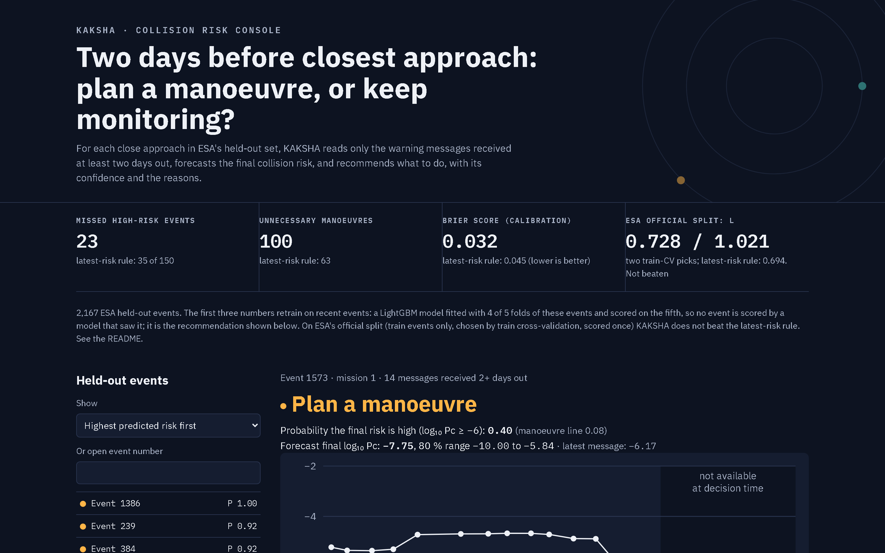

# KAKSHA

Two days before closest approach: plan a manoeuvre, or keep monitoring?

Satellite operators get conjunction data messages (CDMs) warning of close approaches, with a
collision probability (Pc) that is updated for days. They must decide early whether to spend fuel on an
avoidance manoeuvre. KAKSHA reads only the messages received at least two days before closest
approach, forecasts the final risk, and recommends **plan a manoeuvre** or **monitor**, with a calibrated
probability, a range for the final risk, and the three things that drove the call.

StarForge 2026 (BMSITM), Software track, problem SW-5. Team: The Good Engineers.



## Results on ESA's held-out events
Data: ESA's Collision Avoidance Challenge dataset, real anonymised CDMs from 2015-2019
(Zenodo 10.5281/zenodo.4463683, CC-BY-4.0). 2,167 held-out events, 150 of which end high risk
(log10 Pc >= -6). Scored with the competition's own metric: L = MSE on high-risk events / F2, lower is better
(Uriot et al., Astrodynamics 2022). Every number below is in `results/*.csv`, written by a script; the full
tables are in [`docs/RESULTS.md`](docs/RESULTS.md).

### What KAKSHA measurably does better (retrained on recent events; the console's recommendation)
ESA's train and test events behave differently: of the events whose latest message said "high risk", 261 of 308
ended low in the train set but only 63 of 178 in the test set (`results/data_summary.csv`). An operator would
retrain on recent events, so we score the test events in 5 folds, each predicted by a LightGBM model trained on
ESA's train events plus the other 4 folds (no event is scored by a model that saw it):

| | Latest-message rule | KAKSHA LightGBM |
|---|---|---|
| High-risk events missed (of 150) | 35 | **23** |
| Unnecessary manoeuvres | **63** | 100 |
| ESA score L | 0.694 | **0.674** |
| Brier score of the probability | 0.045 | **0.032** |

The probabilities are calibrated (events given 0.6-0.8 ended high risk 70 % of the time). The 80 % range held
the final risk for 94 % of all events but only 70 % of high-risk ones (`results/calibration.csv`,
`results/uncertainty.csv`).

### ESA's official split: not beaten
On the competition's own protocol (train on ESA's train events, score the test events once), **KAKSHA does not
beat the latest-CDM baseline.** We made two clean attempts. Each was chosen *only* by one event-grouped 5-fold
cross-validation on ESA's train events (lowest mean fold L), then scored on the test set once:

| Official split | ESA score L | MSE on high-risk | F2 |
|---|---|---|---|
| Latest-CDM baseline | **0.694** | **0.513** | **0.739** |
| Rule set (`tune.py --select`, `results/cv_selection.csv`, 288 configs) | 1.021 | 0.705 | 0.691 |
| Latest risk + shrunk ridge correction (`tune.py --select-correction`, `results/cv_selection_correction.csv`, 1,080 configs) | 0.728 | 0.526 | 0.723 |

The second attempt follows the challenge paper's advice: train on events like the test ones (latest risk >= -8,
last CDM within 2.5 days), predict the latest risk plus a ridge correction, and let cross-validation choose how
far to move from the baseline (shrinkage 0 reproduces it exactly; CV chose 0.25). It also searched separate
classifiers for the two failure cases (latest high but final low; latest low but final high); CV rejected both.
Train cross-validation did not predict test performance here, which matches the paper's finding that the train
and test sets differ by mission and that train scores barely correlated with test scores.

Disclosure: before we started logging, we ran about 60 exploratory test scorings in scratch scripts, and two
candidates chosen after them (following the published winner's rules, whose thresholds were partly tuned on the
competition leaderboard) scored L 0.676 and 0.691. Because those choices were made after seeing test scores, we
do not count them. Every test evaluation is in `results/test_log.csv`. Our metric code reproduces the paper's
published baseline exactly (L = 0.694; checked in `test_kaksha.py` and CI). The published winner scored 0.556.

## How it works
1. `scripts/get_data.py` downloads the dataset (MD5-checked) into `data/` (never committed).
2. `kaksha.py` keeps events whose last message is within 1 day of closest approach, drops every message
   closer than 2 days, and builds one row per event: the latest message plus trends over the history
   (154 features). It refuses any message inside the cutoff.
3. `train.py` fits gradient-boosted trees for P(final risk high), calibrates them with isotonic regression,
   picks the manoeuvre line that maximises F2 on out-of-fold training predictions (recall weighs 4x
   precision, as in the competition), and builds an empirical 10-90 % range for the final risk.
   Reasons come from per-event feature contributions of the tree model.
4. `server.py` + `web/index.html`: the operator console. Pick an event, see its risk history with the
   2-day cutoff shaded, the recommendation and reasons, then "Reveal what happened".

## Run it
```
python -m pip install -r requirements.txt
python scripts/get_data.py          # 221 MB download from Zenodo
python -m pytest -q                 # split, cutoff and metric checks
python tune.py --select             # train-only 5-fold CV pick (rules), results/cv_selection.csv
python tune.py --select-correction  # train-only 5-fold CV pick (shrunk correction)
python train.py                     # about 2 minutes; writes results/*.csv
python evaluate_official.py clean   # ONE logged test evaluation (appends to results/test_log.csv)
python scripts/results_md.py        # docs/RESULTS.md from the CSVs
python -m uvicorn server:app --port 8780   # http://localhost:8780
```
Our page scores 0 axe-core accessibility problems (checked with our `a11y.py`, desktop and mobile widths).

## Known limits (honest status)
- Working today: data pipeline, both evaluation protocols, calibrated recommendation, console.
- On ESA's official split (train events only) KAKSHA does not beat the latest-CDM baseline.
- Ranges are too narrow for high-risk events (70 % coverage for an 80 % range).
- Most catches are events sitting near the line; events that jump from far below it are still missed.
- The demo event (1573) was picked after the fact to show a catch; the console's filters show misses and
  unnecessary manoeuvres just as easily.
- A research prototype on anonymised historical data, not an operational system.

## Next (24-hour round, if shortlisted)
Sequence models over the message history, a cost slider in fuel and Pc terms, per-mission calibration,
better ranges for high-risk events, and a live CDM feed format (CCSDS CDM).

## Team
How we work and who owns what: [`CONTRIBUTING.md`](CONTRIBUTING.md). Each person's tasks: [`tasks/`](tasks/).
Design references: [`design/REFS.md`](design/REFS.md). Deck: [`deck/`](deck/).
